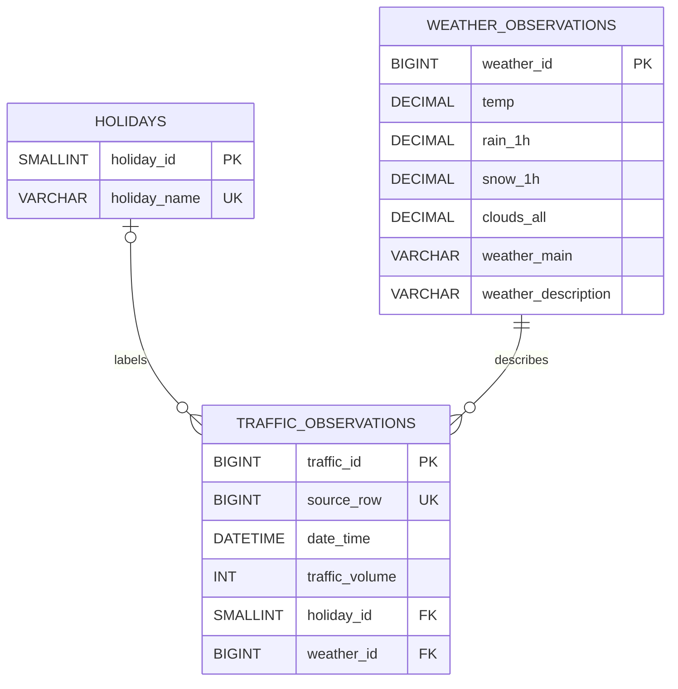

# Time Series Analysis and Forecasting

## Project Overview

This project explores time-series data analysis and forecasting through multiple tasks. It aims to identify patterns and trends in historical data, apply appropriate analytical and forecasting techniques, and evaluate model performance using relevant metrics.

Each part of the project focuses on its assigned analysis and methodology. The sections below document the datasets, approaches, findings, and results for each task.

---

# Part 1: Metro Interstate Traffic Volume Analysis and Forecasting

## 1. Objective

The objective of Part 1 is to analyze historical traffic volume data, identify temporal patterns and trends, and develop forecasting models using historical traffic observations.

## 2. Dataset

**Dataset:** Metro Interstate Traffic Volume

**Source:** [Metro Interstate Traffic Volume — Kaggle](https://www.kaggle.com/datasets/uciml/metro-interstate-traffic-volume)

The dataset contains 48,204 records and nine columns, including timestamps, traffic volume, weather conditions, and holiday information.

- **Target variable:** `traffic_volume`
- **Time column:** `date_time`

## 3. Data Preparation

The data preparation process included:

- Inspecting data types, missing values, and duplicate records.
- Investigating repeated timestamps and anomalous rainfall values.
- Handling missing values and consolidating repeated timestamps.
- Sorting observations chronologically.
- Preparing time-based and lag features for forecasting.

## 4. Exploratory Data Analysis

Six questions guided the exploratory analysis:

1. How does traffic volume vary by hour of the day?
2. How does average traffic differ between weekdays and weekends?
3. Which days of the week experience the highest and lowest traffic?
4. How does traffic volume vary by month?
5. What trends are visible through a moving average?
6. How strongly is traffic volume related to the previous available observation?

Visualizations were used to examine traffic patterns and communicate the findings.

## 5. Forecasting Methodology

Two regression models were developed and evaluated:

- **Linear Regression:** Baseline model.
- **Random Forest Regressor:** Model tuned using validation data.

The dataset was split chronologically into training (70%), validation (15%), and test (15%) sets to preserve temporal order. Model performance was assessed using Mean Absolute Error (MAE), Root Mean Squared Error (RMSE), and the coefficient of determination (R²).

## 6. Results

| Model | MAE | RMSE | R² |
|---|---:|---:|---:|
| Linear Regression | 487.17 | 676.41 | 0.8832 |
| Random Forest | 149.60 | 236.63 | 0.9857 |

The Random Forest model outperformed Linear Regression across all three test metrics, achieving lower prediction errors and a higher R² score.

## 7. Key Findings

- Average traffic volume was highest around 16:00 and lowest around 03:00.
- Weekday traffic was higher on average than weekend traffic.
- Friday had the highest average traffic by day of the week, while Sunday had the lowest.
- August had the highest average traffic by month, while December had the lowest.
- The Random Forest model captured traffic patterns effectively and achieved strong test performance.

## 8. Limitations

The dataset contains gaps and repeated timestamps. Consequently, lag features refer to previous available observations, which are not always exactly one hour apart. This limitation should be considered when interpreting the forecasting results.

---

# Part 2: SQL and MongoDB Database Design

## 1. Design choices

Part 2 uses the same Metro Interstate Traffic Volume dataset as Part 1. The source CSV linked above is also available from the [UCI repository](https://archive.ics.uci.edu/dataset/492/metro+interstate+traffic+volume). Run `scripts/prepare_data.py` on the original nine-column CSV before loading it into either database. This script reproduces the Part 1 notebook's cleaning: it fills missing holiday labels with `"None"`, treats rainfall `9831.3` as invalid, groups repeated timestamps by averaging numeric columns and keeping the first holiday/weather labels, sorts chronologically, and fills missing rainfall with its median.

With the source dataset, this preparation produces **40,575 observations** from 48,204 source rows, consolidating 7,629 repeated-timestamp rows. The prepared data covers **2012-10-02 09:00:00 through 2018-09-30 23:00:00** and has no missing values. The `data/` directory is ignored by Git so the downloaded source and prepared dataset are not accidentally committed.

Each cleaned row becomes one database traffic observation. `source_row` records that row's one-based position in the prepared CSV, preserving a stable identifier for each observation.

The MySQL schema has three tables:

- `traffic_observations` stores the timestamp, traffic volume, source row, and foreign keys.
- `weather_observations` stores the weather fields associated with an observation.
- `holidays` stores each distinct holiday name. A traffic observation without a holiday has a `NULL` holiday key.

Every traffic row refers to one weather row. This retains each source row's weather values even when multiple rows share a timestamp. MongoDB uses one `traffic_observations` document per input row and embeds the weather fields because they are read together with the traffic measurement.

### ERD



## 2. Files

- `sql/schema.sql` creates the MySQL database and its three tables.
- `sql/queries.sql` contains four SQL examples: latest observation, date range, hourly average, and holiday average.
- `scripts/load_sql.py` loads the prepared CSV into MySQL in one transaction.
- `mongodb/sample_document.json` shows the document structure.
- `mongodb/queries.js` contains the corresponding MongoDB queries.
- `scripts/load_mongodb.py` loads the prepared CSV into MongoDB in batches.
- `scripts/prepare_data.py` reproduces the Part 1 notebook's cleaning steps.
- `scripts/query_actual_data.py` runs the SQL query equivalents on an in-memory SQLite database and computes the matching MongoDB query results from the actual prepared dataset.
- `outputs/task2_query_results.md` contains the outputs calculated from the actual cleaned data.

Both loaders preserve blank values as database `NULL`/MongoDB `null`, preserve repeated timestamps, and reject malformed timestamps or invalid numeric values. The source dataset does not include a timezone, so timestamp values are kept as timezone-naive wall-clock readings. PyMongo encodes naive datetimes as UTC; that is a storage convention here, not evidence that the original observations were collected in UTC.

## 3. Set up and load the data

Download the original CSV from the Kaggle link above or the UCI dataset page, extract/decompress it if the download is an archive, and place `Metro_Interstate_Traffic_Volume.csv` at `data/Metro_Interstate_Traffic_Volume.csv`. Keep the data file and database credentials out of version control. Install the Python database drivers and pandas from the repository root:

```powershell
python -m pip install -r requirements.txt
```

Apply the same cleaning steps used in Part 1 to create the CSV consumed by both database loaders:

```powershell
python scripts/prepare_data.py
```

Create the MySQL schema using a MySQL account with database/table creation privileges:

```powershell
Get-Content -Raw .\sql\schema.sql | mysql -u YOUR_MYSQL_USER -p
```

Set the connection environment variables in PowerShell (replace the example values; do not commit real credentials):

```powershell
$env:MYSQL_HOST = "127.0.0.1"
$env:MYSQL_PORT = "3306"
$env:MYSQL_USER = "YOUR_MYSQL_USER"
$env:MYSQL_PASSWORD = "YOUR_MYSQL_PASSWORD"
$env:MYSQL_DATABASE = "time_series_traffic"
python scripts/load_sql.py "data\cleaned_traffic.csv"
```

The SQL loader expects an empty `traffic_observations` table to prevent duplicate imports. For a repeatable fresh import, create a fresh database/schema before running it again rather than deleting data implicitly in the loader.

For MongoDB, set a URI and load the same CSV:

```powershell
$env:MONGODB_URI = "mongodb://localhost:27017"
$env:MONGODB_DATABASE = "time_series_traffic"
python scripts/load_mongodb.py "data\cleaned_traffic.csv"
```

The MongoDB loader uses the source row number as `_id`, so importing the same CSV again updates matching documents instead of duplicating them. If a later CSV contains fewer rows, remove any stale trailing documents deliberately before treating it as a complete replacement.

## 4. Run the queries and record results

Run the SQL examples after loading:

```powershell
Get-Content -Raw .\sql\queries.sql | mysql -u YOUR_MYSQL_USER -p
```

Run the MongoDB examples with `mongosh`:

```powershell
mongosh "$env:MONGODB_URI" mongodb/queries.js
```

The scripts include four queries per database. Their date-range examples use a half-open interval from 1 January 2016 inclusive to 1 February 2016 exclusive. The actual cleaned dataset's query results are recorded in `outputs/task2_query_results.md`; these were calculated against a local SQLite copy and matching MongoDB-style aggregations because MySQL and MongoDB servers were not available in the development environment. Run the database query scripts against your live MySQL and MongoDB instances and include their output or screenshots as final evidence that the queries execute in those systems.
